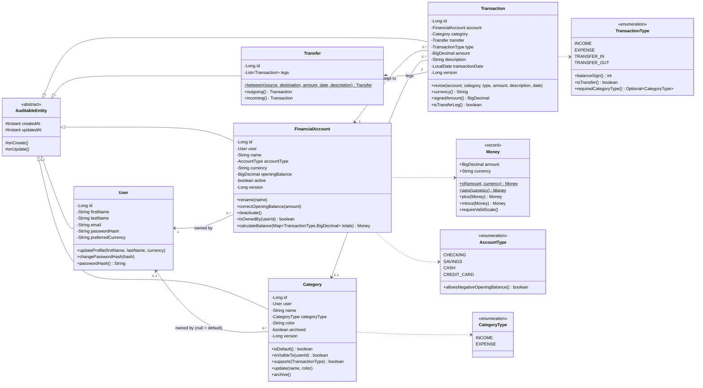

# Nest — UML Class Diagram (Sprint 1 Design)

This is the planned design for Sprint 1. The as-built version will be in `docs/sprint1/uml_class_diagram.md`. The diagrams use Mermaid, which renders on GitHub and in VS Code with a Mermaid extension.

## 1. Domain Model

## 2. Service and Web Layers

```mermaid
classDiagram
    direction TB

    class AuthController
    class UserController
    class FinancialAccountController
    class CategoryController
    class TransactionController
    class TransferController

    class AuthService {
        <<interface>>
        +register(RegisterRequest) UserResponse
        +login(LoginRequest) AuthResponse
    }
    class UserService {
        <<interface>>
        +getProfile(userId) UserResponse
        +updateProfile(userId, UpdateProfileRequest) UserResponse
    }
    class FinancialAccountService {
        <<interface>>
        +create(userId, req) AccountResponse
        +list(userId, includeInactive) List~AccountResponse~
        +get(userId, accountId) AccountResponse
        +update(userId, accountId, req) AccountResponse
        +deactivate(userId, accountId)
    }
    class CategoryService {
        <<interface>>
        +create(userId, req) CategoryResponse
        +list(userId, type, includeArchived) List~CategoryResponse~
        +update(userId, categoryId, req) CategoryResponse
        +archive(userId, categoryId)
    }
    class TransactionService {
        <<interface>>
        +create(userId, req) TransactionResponse
        +search(userId, filter, pageable) PageResponse
        +get(userId, id) TransactionResponse
        +update(userId, id, req) TransactionResponse
        +delete(userId, id)
    }
    class TransferService {
        <<interface>>
        +create(userId, req) TransferResponse
        +get(userId, id) TransferResponse
        +delete(userId, id)
    }

    class TokenService {
        <<interface>>
        +issue(User) AccessToken
    }
    class CurrentUserProvider {
        <<interface>>
        +currentUserId() Long
    }

    AuthController --> AuthService
    UserController --> UserService
    FinancialAccountController --> FinancialAccountService
    CategoryController --> CategoryService
    TransactionController --> TransactionService
    TransferController --> TransferService
    UserController --> CurrentUserProvider
    FinancialAccountController --> CurrentUserProvider
    CategoryController --> CurrentUserProvider
    TransactionController --> CurrentUserProvider
    TransferController --> CurrentUserProvider

    AuthServiceImpl ..|> AuthService
    UserServiceImpl ..|> UserService
    FinancialAccountServiceImpl ..|> FinancialAccountService
    CategoryServiceImpl ..|> CategoryService
    TransactionServiceImpl ..|> TransactionService
    TransferServiceImpl ..|> TransferService
    JwtTokenService ..|> TokenService
    SecurityContextCurrentUserProvider ..|> CurrentUserProvider

    AuthServiceImpl --> UserRepository
    AuthServiceImpl --> TokenService
    UserServiceImpl --> UserRepository
    FinancialAccountServiceImpl --> FinancialAccountRepository
    FinancialAccountServiceImpl --> TransactionRepository
    CategoryServiceImpl --> CategoryRepository
    TransactionServiceImpl --> TransactionRepository
    TransactionServiceImpl --> FinancialAccountRepository
    TransactionServiceImpl --> CategoryRepository
    TransferServiceImpl --> TransferRepository
    TransferServiceImpl --> FinancialAccountRepository
```

## Notes on Relationships

- **Composition (filled diamond), Transfer → Transaction:** a transfer leg cannot exist without its transfer, and both legs are created and deleted together.
- **Association, Transaction → Category:** a category outlives its transactions. That is why categories are archived, not deleted.
- **Inheritance, `AuditableEntity`:** shared audit state only. There is no polymorphic domain behaviour, so subclasses cannot violate Liskov substitution.
- **Interfaces:** every controller depends on an interface, never on `*Impl` (Dependency Inversion).
