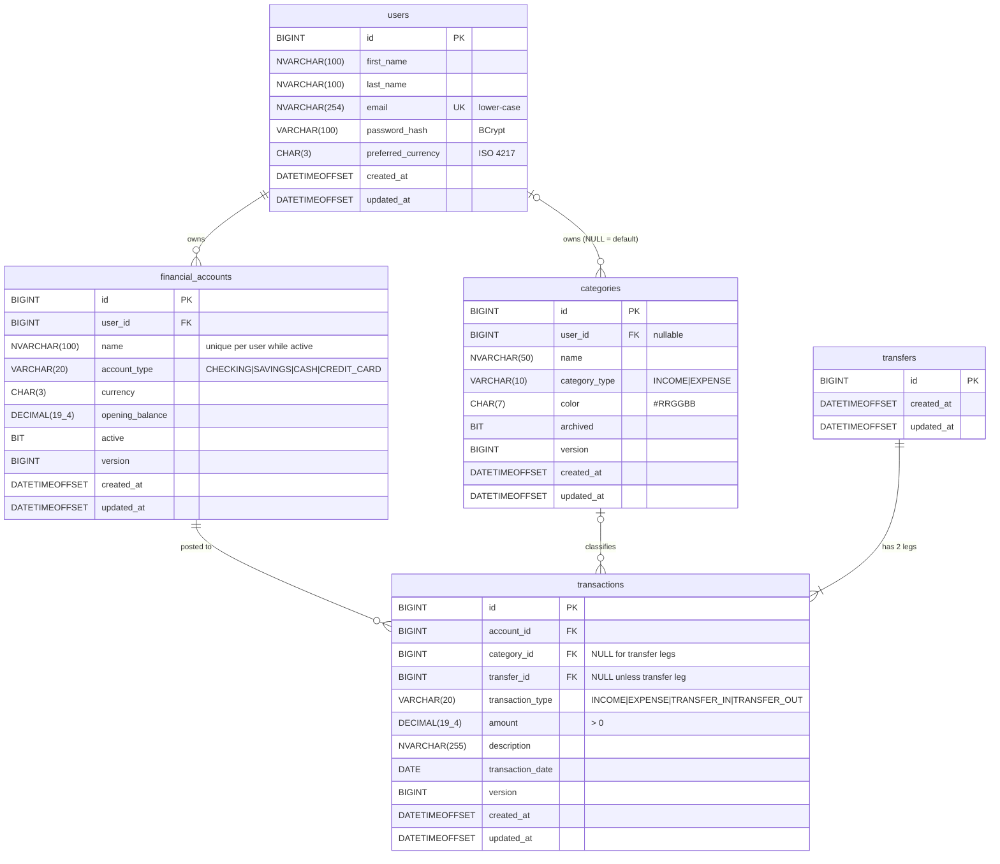

# Nest — Entity Relationship Diagram (Sprint 1)

SQL Server schema for Sprint 1. Each table is created by a Flyway migration in `backend/src/main/resources/db/migration`. Later sprints add tables in new migrations and never edit applied ones.

## Constraints

| Table | Constraint | Purpose |
|-------|------------|---------|
| `users` | `UQ_users_email` | One account per email (stored lower-case, so case-insensitive) |
| `financial_accounts` | `FK → users`, `CK account_type IN (...)` | Ownership; valid enum |
| `financial_accounts` | `UX_financial_accounts_user_name_active` filtered `WHERE active = 1` | Unique active names; a closed "Visa" doesn't block a new "Visa" |
| `categories` | `FK → users` (nullable), `CK category_type IN (...)`, `CK color LIKE '#[0-9A-Fa-f]…'` | Ownership; valid enum and colour |
| `categories` | `UX_categories_user_name_type` filtered `WHERE user_id IS NOT NULL AND archived = 0` | Unique user category names per type |
| `categories` | `UX_categories_default_name_type` filtered `WHERE user_id IS NULL` | Unique default category names per type |
| `transactions` | `FK → financial_accounts`, `FK → categories`, `FK → transfers` | Referential integrity (all `NO ACTION`) |
| `transactions` | `CK amount > 0` | Direction lives in the type, never in the sign |
| `transactions` | `CK_transactions_shape` | `INCOME`/`EXPENSE` ⇒ category NOT NULL and transfer NULL; `TRANSFER_*` ⇒ transfer NOT NULL and category NULL |
| `transactions` | `UX_transactions_transfer_type` filtered `WHERE transfer_id IS NOT NULL` on `(transfer_id, transaction_type)` | At most one OUT and one IN leg per transfer |

## Indexes

| Index | Supports |
|-------|----------|
| `IX_transactions_account_date (account_id, transaction_date)` | Account history, monthly summaries, balance aggregation |
| `IX_transactions_category (category_id)` | Category filters and category spending |
| `IX_financial_accounts_user (user_id)` | Listing a user's accounts |
| `IX_categories_user (user_id)` | Listing visible categories |

## Normalisation Notes (3NF)

- **No stored balance:** a balance is a function of `opening_balance` and transaction rows, so storing it would create an update anomaly.
- **No `currency` on `transactions`:** it is functionally dependent on `account_id`. Storing it would be a transitive dependency (`id → account_id → currency`).
- **No `is_default` on `categories`:** it is equivalent to `user_id IS NULL`.
- **Transfer legs repeat amount and date:** each leg is a fact about *its own* account's ledger, as in double-entry bookkeeping. Equality between the two legs is enforced by the `Transfer.between` factory and covered by tests.
- **Ownership of a transaction** is reached through `account_id → user_id`. It is not duplicated on the transaction.

## Seed Data

The categories migration seeds system categories (`user_id = NULL`):

- **Income:** Salary, Freelance, Investments, Gifts, Refunds, Other Income
- **Expense:** Housing, Utilities, Groceries, Dining Out, Transportation, Car, Insurance, Healthcare, Subscriptions, Entertainment, Shopping, Education, Personal Care, Travel, Other Expenses
