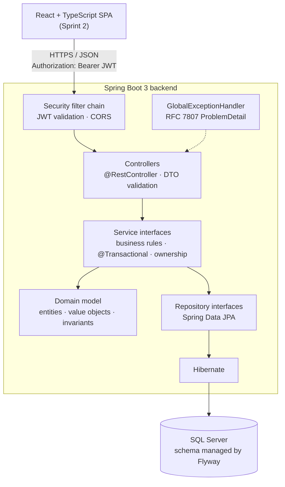

# Nest — System Design

This document describes how Nest is built and why. It covers the Sprint 1 domain in detail and sets out the conventions that later sprints follow. Diagrams: [class_diagram.md](class_diagram.md), [er_diagram.md](er_diagram.md), [crc_cards.md](crc_cards.md).

---

## 1. Architecture



### Layer rules

| Layer | Package | Responsibility | May depend on |
|-------|---------|----------------|---------------|
| Controller | `controller` | HTTP mapping, `@Valid` request DTOs, status codes, resolving the current user | service interfaces, dto, security |
| Service | `service`, `service.impl` | Use cases, business rules, transaction boundaries, authorization | model, repository, dto, mapper, exception |
| Domain model | `model` | Entities, enums, value objects; enforces its own invariants | exception (domain exceptions only) |
| Repository | `repository` | Persistence queries; no business rules | model |
| DTO / Mapper | `dto`, `mapper` | API contracts and entity ↔ DTO translation | model |
| Cross-cutting | `config`, `security`, `exception`, `validation` | Wiring, JWT, error translation, custom constraints | — |

Dependencies point downward only. Controllers never touch repositories. The model never imports Spring Web classes. JPA entities never leave the service layer: controllers receive and return DTOs only.

### Improvements over BookBuddy

Nest keeps BookBuddy's model / repository / service / controller structure and fixes what caused friction there:

| BookBuddy | Nest |
|-----------|------|
| Concrete service classes with `@Autowired` | Service interfaces plus constructor injection (DIP, easy mocking) |
| try/catch in every controller, plain-string errors | One `@RestControllerAdvice` returning RFC 7807 `ProblemDetail` |
| Entities returned from endpoints (`@JsonIgnore` on fields) | Request/response DTOs; entities never serialised |
| Login returned the user; no token | Stateless JWT bearer tokens |
| SQLite, `ddl-auto` | SQL Server with versioned Flyway migrations; Hibernate `validate` only |
| `@CrossOrigin` on each controller | One central CORS configuration |
| Lombok | Plain Java, so accessors and mutators are deliberate (encapsulation) |

---

## 2. Technology Choices

| Concern | Choice | Reason |
|---------|--------|--------|
| Language | Java 21 | LTS; records for DTOs, pattern matching, `switch` expressions |
| Framework | Spring Boot 3.5.x | Latest maintained 3.x line; first-class Testcontainers and Flyway support |
| Persistence | Spring Data JPA / Hibernate 6 | Repository abstraction, Specification support, optimistic locking |
| Database | SQL Server 2022 (Docker) | Required stack; `DECIMAL`, filtered unique indexes, `DATETIMEOFFSET` |
| Migrations | Flyway (`flyway-sqlserver`) | Reproducible, reviewable schema history |
| Auth | Spring Security + OAuth2 Resource Server (Nimbus JWT, HS256) | Standard bearer-token validation without a third-party JWT library |
| Docs | springdoc-openapi | Swagger UI generated from the code |
| Tests | JUnit 5, Mockito, AssertJ, Testcontainers `MSSQLServerContainer`, MockMvc | Fast unit tests plus realistic integration tests |
| Frontend (Sprint 2) | React, TypeScript, Vite, React Router, Axios, Tailwind, Recharts | As specified |

---

## 3. Domain Model (Sprint 1)

### 3.1 Entities and value objects

| Type | Kind | Purpose |
|------|------|---------|
| `User` | Entity | Owner of all financial data; profile and preferred currency |
| `FinancialAccount` | Entity (aggregate root) | A place money is held or owed; fixed currency; opening balance |
| `Category` | Entity | Classifies income or expenses; system default or user-owned |
| `Transaction` | Entity | One movement of money on one account |
| `Transfer` | Entity (aggregate root) | Groups the two linked entries of a transfer |
| `Money` | Value object (record) | Amount + currency with currency-safe arithmetic and scale rules |
| `AccountType`, `CategoryType`, `TransactionType` | Enums with behaviour | Encode domain rules polymorphically |
| `AuditableEntity` | `@MappedSuperclass` | `createdAt` / `updatedAt` audit timestamps |

### 3.2 Key financial decisions

**D1. Money representation.** Amounts are `BigDecimal` in Java and `DECIMAL(19,4)` in SQL Server. Four decimal places fit every ISO 4217 currency's minor units, including three-decimal currencies such as BHD. The API rejects input that has more decimals than the currency allows (`Currency.getDefaultFractionDigits()`), instead of silently rounding user input. Derived values such as percentages and allocations (Sprint 2) use `RoundingMode.HALF_EVEN` (banker's rounding) to the currency's minor units. `Money` is the only place this logic lives.

**D2. Currency.** Currency is stored as an ISO 4217 code, `CHAR(3)`, and validated by a custom `@ValidCurrency` constraint. An account's currency is fixed at creation. A transaction's currency is the currency of its account. It is **derived, not stored**, which keeps the schema in 3NF and makes a mismatch impossible. If a client sends a `currency` on a transaction, it must match the account's currency or the request is rejected.

**D3. Derived balances (no stored balance).** An account's balance is never written directly:

```text
balance = openingBalance + Σ INCOME + Σ TRANSFER_IN − Σ EXPENSE − Σ TRANSFER_OUT
```

The repository returns one total per transaction type (a single `GROUP BY` query). The pure method `FinancialAccount.calculateBalance(totals)` combines them. This avoids the classic "stored balance drifts from history" bug, and the calculation is unit-testable without a database. A stored balance is a cache that can go stale; if performance ever requires one, it would be added as an explicit, rebuildable projection.

**D4. Transaction types carry their direction.** `TransactionType` has four values: `INCOME`, `EXPENSE`, `TRANSFER_IN`, `TRANSFER_OUT`. Each constant knows its balance effect (`+1` / `−1`), whether it counts as spending or income, and whether it requires a category. The specification listed a single `TRANSFER` type. Splitting it in two makes each ledger entry self-describing, so a balance can be computed without joining to the transfer. `isTransfer()` still treats both as transfers.

**D5. Transfers as linked entries.** A transfer creates one `Transfer` row and two `Transaction` rows: `TRANSFER_OUT` on the source account and `TRANSFER_IN` on the destination. Both have the same amount and date and point to the same `transfer_id`. The rules:
- Source ≠ destination. Both accounts must be owned by the user, active, and in the same currency. The MVP has no foreign-exchange support.
- Creation happens in one `@Transactional` service method. `Transfer.between(...)` is a factory that builds both legs, so an unbalanced transfer cannot exist.
- Transfer legs cannot be edited or deleted through `/api/transactions`. To delete a transfer, use `DELETE /api/transfers/{id}`, which removes both legs. To correct a transfer, delete it and create it again.
- Reports count only `INCOME` and `EXPENSE`, so transfers are never counted as spending.

**D6. Credit card convention.** All account types use one sign convention: **positive = money you have, negative = money you owe.** For a credit card:
- A purchase is an `EXPENSE` on the card, so the balance becomes more negative.
- A payment is a transfer from checking to the card. The card's `TRANSFER_IN` moves the balance toward zero.
- A refund is recorded as `INCOME` on the card. Sprint 2 introduces a refund category so budgets can treat refunds as negative spending.

Because every account type uses the same formula, the dashboard (Sprint 2) can compute net worth per currency by simple addition. `AccountType.allowsNegativeOpeningBalance()` is `true` for `CREDIT_CARD` and `CHECKING` (overdraft) and `false` for `SAVINGS` and `CASH`.

**D7. Archive instead of delete.** `DELETE /api/accounts/{id}` sets `active = false`. `DELETE /api/categories/{id}` sets `archived = true`. History is never orphaned, and foreign keys stay `NO ACTION`. Inactive accounts and archived categories cannot be used by new or edited transactions. Transactions themselves are hard-deleted, because removing a mistaken record is the user's intent.

**D8. Default categories.** System categories have `user_id = NULL`. `isDefault` is **derived** (`user == null`), not stored. Users can read default categories but cannot modify them.

**D9. Optimistic locking.** `FinancialAccount`, `Category`, and `Transaction` have a `@Version` column. When two edits conflict, the API returns `409 Conflict` instead of silently overwriting one of them.

**D10. Dates and time.** `transactionDate` is a `LocalDate` (`DATE`): the user's calendar day, with no timezone ambiguity. Audit timestamps are `Instant` (`DATETIMEOFFSET`, UTC).

---

## 4. Object-Oriented Design

### 4.1 Encapsulation
- All entity fields are private, and there are no public setters for sensitive or invariant-bearing state. State changes go through intention-revealing methods: `account.rename(name)`, `account.deactivate()`, `category.archive()`, `transaction.revise(...)`, `user.changePasswordHash(hash)`.
- Constructors and factories validate invariants. For example, `new Transaction(...)` rejects a non-positive amount, a category of the wrong type, or an inactive account. An invalid object cannot be constructed.
- `User.passwordHash` has no getter in any DTO, and only `AuthServiceImpl` reads it, to verify passwords.
- Collections are not exposed for external mutation.

### 4.2 Abstraction
- Each use case is behind a service interface (`TransactionService`, ...). Controllers depend only on the interface.
- `TokenService` hides JWT details: controllers and services never see Nimbus classes.
- `CurrentUserProvider` hides *how* the user is identified (the JWT subject today; it could be a session cookie tomorrow).

### 4.3 Inheritance (used sparingly)
- `AuditableEntity` is a `@MappedSuperclass` holding `createdAt`/`updatedAt` and their lifecycle callbacks. It is a genuine IS-A relationship: every auditable entity *is* an auditable record, and the superclass has no domain behaviour that subclasses could break.
- Account types are **not** modelled as subclasses (`CheckingAccount extends FinancialAccount`). They differ only in a few rules, not in state or behaviour, so an enum with behaviour is simpler and avoids JPA inheritance mapping costs. The same reasoning applies to transaction types.
- Custom exceptions form a small hierarchy (`NestException` → `ResourceNotFoundException`, `BusinessRuleException`, `ConflictException`, ...). The global handler maps each subtype to an HTTP status.

### 4.4 Polymorphism
- **Enum constant behaviour:** `TransactionType.balanceSign()`, `TransactionType.requiresCategory()`, and `AccountType.allowsNegativeOpeningBalance()` replace `if/switch` chains spread across services.
- **Interfaces with interchangeable implementations:** `TokenService` (JWT, or a fake in tests), `CurrentUserProvider`, and from Sprint 2 `SavingsAllocationStrategy` (percentage / fixed) and Sprint 3 `FinancialInsightRule`.
- **Specifications:** each filter criterion is a `Specification<Transaction>` composed with `and(...)`.

### 4.5 Composition
- `Transaction` *has* an account and a category. `Transfer` *has* two transactions. `Money` composes an amount and a currency.

---

## 5. SOLID Principles

| Principle | Where it shows up |
|-----------|-------------------|
| **Single Responsibility** | `AuthService` (credentials and tokens) is separate from `UserService` (profile). `TransferService` is separate from `TransactionService`, because transfers have their own invariants. Mappers only translate. `GlobalExceptionHandler` only translates errors. |
| **Open/Closed** | New transaction filters are new `Specification`s, with no change to the query method. New insight rules (Sprint 3) are new `FinancialInsightRule` beans. New savings strategies (Sprint 2) are new `SavingsAllocationStrategy` implementations. |
| **Liskov Substitution** | Any `TokenService` or `CurrentUserProvider` implementation can replace another without changing callers. Exception subtypes are handled through their base type. |
| **Interface Segregation** | Small, use-case-focused service interfaces. `TokenService` exposes only `issue(user)`. `CurrentUserProvider` exposes only `currentUserId()`. |
| **Dependency Inversion** | Controllers depend on service interfaces, and services depend on repository interfaces. Spring injects the implementations through constructors, so unit tests substitute mocks. |

---

## 6. Design Patterns

| Pattern | Where | Why it is justified |
|---------|-------|---------------------|
| Repository | `*Repository extends JpaRepository` | Separates persistence from business logic, and ownership-aware finders live in one place |
| Dependency Injection | Constructor injection everywhere | Explicit dependencies, immutable fields, easy unit testing |
| DTO + Mapper | `dto.request`, `dto.response`, `mapper` | Stable API contract independent of the schema; prevents leaking `passwordHash` |
| Factory method | `Transfer.between(...)`, `Money.of(...)` | Creating a transfer means building three consistent objects; a factory makes partial creation impossible |
| Specification | `TransactionSpecifications` | Combines optional filters without combinatorial repository methods or string-built queries |
| Strategy | `SavingsAllocationStrategy` (Sprint 2) | Percentage vs. fixed savings are interchangeable algorithms chosen per budget |
| Rule engine (Strategy collection) | `FinancialInsightRule` (Sprint 3) | Each insight is independent; new rules require no change to the engine |
| Template / chain | Spring Security filter chain | Authentication is handled once, before any controller runs |

Patterns not used, and why: no Abstract Factory, Builder, or Visitor. The Sprint 1 domain has no variation that would justify them.

---

## 7. Service Responsibilities

| Service | Responsibilities |
|---------|------------------|
| `AuthService` | Register (normalise email, enforce uniqueness, hash password); log in (verify hash in constant time, issue token) |
| `UserService` | Read and update the current user's profile |
| `FinancialAccountService` | Create, list, read, update, and deactivate the user's accounts; compute balances |
| `CategoryService` | List visible categories (default + own); create, update, and archive own categories; resolve a category for use in a transaction |
| `TransactionService` | Create, read, update, and delete INCOME/EXPENSE entries; validate ownership, category compatibility, currency, and scale; filtered pagination |
| `TransferService` | Create transfers atomically; read and delete transfers (both legs) |

Every service method receives the authenticated `userId` from the controller (taken from `CurrentUserProvider`), and every repository lookup is scoped by it.

---

## 8. Database Design

The full ERD is in [er_diagram.md](er_diagram.md). Highlights:

- **Keys:** `BIGINT IDENTITY` surrogate primary keys, with foreign keys on every relationship and `ON DELETE NO ACTION` (archive instead of cascade).
- **Constraints:** `CHECK` constraints mirror domain rules as a second line of defence: `amount > 0`, valid enum values, and the type/category/transfer consistency of a transaction.
- **Uniqueness:** filtered unique indexes:
  - one active account name per user (`WHERE active = 1`)
  - unique category names per owner and type
  - unique email
- **Normalisation (3NF):** derived data is not stored — no balance, no currency on transactions, no `is_default` flag. Every non-key column depends on the key, the whole key, and nothing but the key.
- **Indexes:** `transactions(account_id, transaction_date)` for history and monthly queries; `transactions(category_id)`; `transactions(transfer_id)`.
- **Migrations:** `src/main/resources/db/migration/V{n}__{description}.sql`. Hibernate runs with `ddl-auto: validate`, so the code and schema cannot drift silently.

---

## 9. Security Approach

| Concern | Approach |
|---------|----------|
| Authentication | Stateless JWT (HS256) issued at login, sent as `Authorization: Bearer`. Claims: `sub` (user id), `email`, `iss=nest`, `iat`, `exp`. The default lifetime is 60 minutes (configurable). |
| Why JWT over sessions | The API is consumed by a separate SPA, and horizontal scaling and Postman testing are simpler without server-side session state. Trade-off: there is no server-side logout or revocation in the MVP. Logout discards the token on the client, and lifetimes are short. Refresh tokens and revocation are evaluated in Sprint 3. |
| Secret management | `NEST_JWT_SECRET` (Base64, ≥ 256-bit) and `NEST_DB_PASSWORD` come from the environment. The application fails at startup if the JWT secret is missing or too short. `.env` is git-ignored, and `.env.example` documents the variables. |
| Passwords | BCrypt (strength 12), 8–72 characters (BCrypt's input limit is 72 bytes). |
| Login enumeration | The same `401` message for an unknown email and a wrong password. A dummy BCrypt check runs for unknown emails so response timing is similar. |
| Authorization | All `/api/**` routes except `/api/auth/**` require a valid token. Ownership is enforced in services through user-scoped queries (`findByIdAndUserId`). A resource owned by someone else returns **404**, not 403, so IDs cannot be probed. |
| CSRF | Disabled: there are no cookies, so CSRF does not apply to bearer-token APIs. |
| CORS | Allowed origins come from configuration (`nest.cors.allowed-origins`) and are defined in one place. |
| Errors | RFC 7807 `ProblemDetail` responses. Stack traces and SQL are never returned. Unexpected exceptions are logged server-side with a generic `500` body. |
| Logging | Passwords, tokens, and full request bodies are never logged. |

### Error response format

```json
{
  "type": "about:blank",
  "title": "Validation failed",
  "status": 400,
  "detail": "One or more fields are invalid.",
  "instance": "/api/transactions",
  "timestamp": "2026-10-19T14:03:22.114Z",
  "errors": [ { "field": "amount", "message": "must be greater than 0" } ]
}
```

| Status | When |
|--------|------|
| 400 | Malformed JSON, bean-validation failure, bad query parameter |
| 401 | Missing, invalid, or expired token; bad credentials |
| 403 | Attempt to modify a system default category |
| 404 | Resource doesn't exist **or** isn't owned by the caller |
| 409 | Duplicate email, account name, or category name; optimistic-lock conflict; editing a transfer leg |
| 422 | Request is well-formed but violates a business rule (inactive account, category type mismatch, currency mismatch, too many decimals) |
| 500 | Unexpected error (generic message only) |

---

## 10. Technical Risks

| Risk | Impact | Mitigation |
|------|--------|------------|
| SQL Server image is amd64-only; development Mac is Apple Silicon | Slow or failing local DB | Docker Desktop runs it under Rosetta emulation. The image is pinned in `docker-compose.yml`, and Testcontainers reuses it. |
| Hibernate type mapping differs from the hand-written schema (e.g. `Instant` ↔ `DATETIMEOFFSET`) | Startup failure under `validate` | Integration tests boot against real SQL Server on every build |
| Rounding and precision bugs | Wrong balances | `BigDecimal` only, scale checks in `Money`, and unit tests covering the boundaries |
| Double-counting transfers | Inflated spending | Directional transfer types; reports filter `INCOME`/`EXPENSE` only; tests assert it |
| Cross-user data leaks | Severe privacy breach | User-scoped repository methods, plus a cross-user integration test for every resource |
| Stateless JWT cannot be revoked | A stolen token works until it expires | Short expiry, HTTPS in deployment; revocation reviewed in Sprint 3 |
| Scope creep across three sprints | Unfinished features | Strict per-sprint backlog and an explicit "not included" list |
