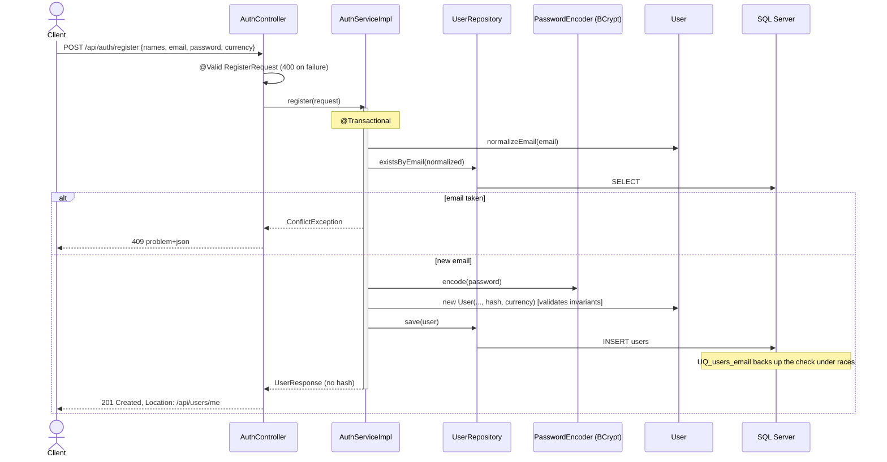
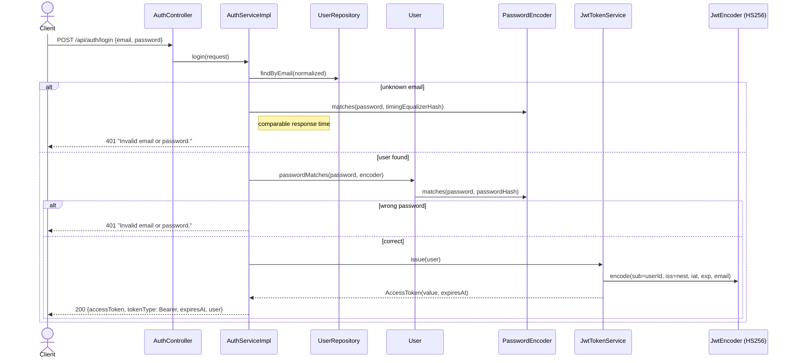
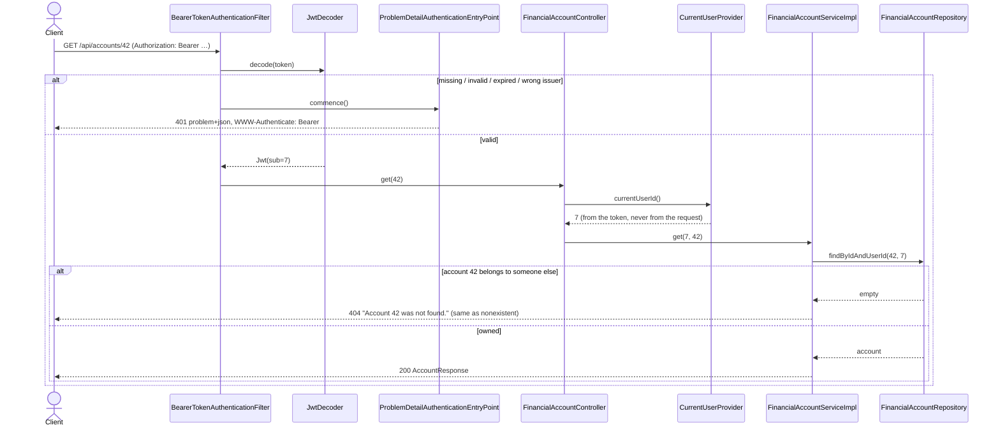
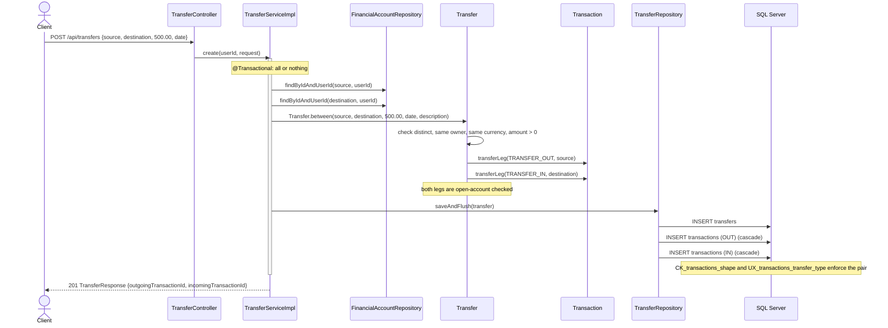
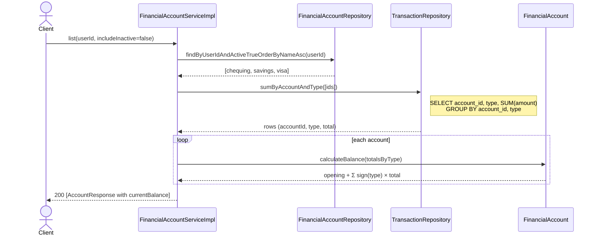

# Sprint 1 — Sequence Diagrams

These diagrams show how the main Sprint 1 use cases flow through the layers. Each one shows where validation, ownership checks, and transaction boundaries happen.

## 1. Register



## 2. Login and Token Issue



## 3. Authenticated Request With Ownership Check



## 4. Record an Expense

```mermaid
sequenceDiagram
    actor Client
    participant C as TransactionController
    participant S as TransactionServiceImpl
    participant AR as FinancialAccountRepository
    participant CR as CategoryRepository
    participant T as Transaction
    participant FA as FinancialAccount
    participant CAT as Category
    participant M as Money
    participant TR as TransactionRepository

    Client->>C: POST /api/transactions {accountId, categoryId, EXPENSE, 84.37, date}
    C->>C: @Valid TransactionRequest (amount > 0, required fields)
    C->>S: create(userId, request)
    Note over S: @Transactional
    S->>AR: findByIdAndUserId(accountId, userId)
    AR-->>S: account (or 404)
    S->>S: requireMatchingCurrency(account, request.currency) (422)
    S->>CR: findVisible(categoryId, userId)
    CR-->>S: category (default or own, or 404)
    S->>T: new Transaction(account, category, EXPENSE, amount, ...)
    T->>FA: requireOpenForActivity() (422 if closed)
    T->>CAT: isVisibleTo(owner); requireUsableFor(EXPENSE) (422 if archived or wrong type)
    T->>M: Money.of(amount, account.currency) (422 if too many decimals)
    S->>TR: save(transaction)
    S-->>Client: 201 TransactionResponse (currency = account currency)
```

## 5. Create a Transfer (Atomic)



## 6. List Accounts With Balances (One Aggregate Query)


