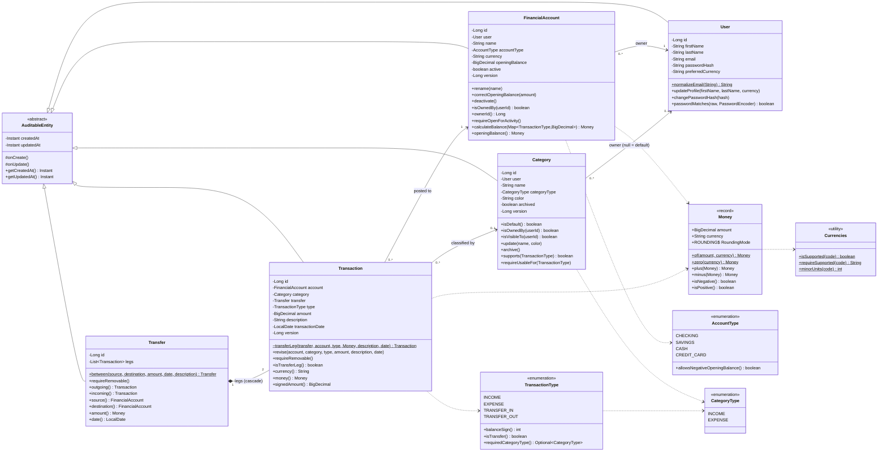
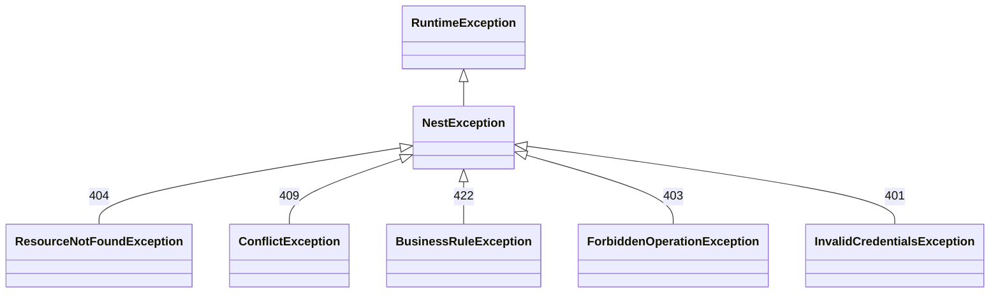

# Sprint 1 — UML Class Diagram (As Built)

This diagram reflects the code at the end of Sprint 1. Differences from the Sprint 0 design ([class_diagram.md](../sprint0/class_diagram.md)) are listed at the end.

## 1. Domain Model (`com.nest.model`)

## 2. Application Layers

```mermaid
classDiagram
    direction TB

    namespace controller {
        class AuthController
        class UserController
        class FinancialAccountController
        class CategoryController
        class TransactionController
        class TransferController
    }

    namespace service {
        class AuthService {<<interface>>}
        class UserService {<<interface>>}
        class FinancialAccountService {<<interface>>}
        class CategoryService {<<interface>>}
        class TransactionService {<<interface>>}
        class TransferService {<<interface>>}
    }

    namespace security {
        class TokenService {<<interface>>}
        class JwtTokenService
        class CurrentUserProvider {<<interface>>}
        class SecurityContextCurrentUserProvider
    }

    namespace repository {
        class UserRepository {<<interface>>}
        class FinancialAccountRepository {<<interface>>}
        class CategoryRepository {<<interface>>}
        class TransactionRepository {<<interface>>}
        class TransferRepository {<<interface>>}
        class TransactionSpecifications {<<utility>>}
    }

    AuthController --> AuthService
    UserController --> UserService
    FinancialAccountController --> FinancialAccountService
    CategoryController --> CategoryService
    TransactionController --> TransactionService
    TransferController --> TransferService
    UserController --> CurrentUserProvider
    FinancialAccountController --> CurrentUserProvider
    CategoryController --> CurrentUserProvider
    TransactionController --> CurrentUserProvider
    TransferController --> CurrentUserProvider

    AuthServiceImpl ..|> AuthService
    UserServiceImpl ..|> UserService
    FinancialAccountServiceImpl ..|> FinancialAccountService
    CategoryServiceImpl ..|> CategoryService
    TransactionServiceImpl ..|> TransactionService
    TransferServiceImpl ..|> TransferService
    JwtTokenService ..|> TokenService
    SecurityContextCurrentUserProvider ..|> CurrentUserProvider

    AuthServiceImpl --> UserRepository
    AuthServiceImpl --> TokenService
    UserServiceImpl --> UserRepository
    FinancialAccountServiceImpl --> FinancialAccountRepository
    FinancialAccountServiceImpl --> TransactionRepository : balance totals
    FinancialAccountServiceImpl --> UserRepository
    CategoryServiceImpl --> CategoryRepository
    CategoryServiceImpl --> UserRepository
    TransactionServiceImpl --> TransactionRepository
    TransactionServiceImpl --> FinancialAccountRepository
    TransactionServiceImpl --> CategoryRepository
    TransactionServiceImpl ..> TransactionSpecifications
    TransferServiceImpl --> TransferRepository
    TransferServiceImpl --> FinancialAccountRepository
```

Cross-cutting classes not shown above:
- **Errors:** `GlobalExceptionHandler`, `ProblemDetails`, and the `NestException` hierarchy (`ResourceNotFoundException`, `ConflictException`, `BusinessRuleException`, `ForbiddenOperationException`, `InvalidCredentialsException`)
- **Configuration:** `SecurityConfig`, `JwtConfig`, `OpenApiConfig`, `ClockConfig`, `SecurityProperties`, `CorsProperties`, `JwtProperties`
- **Security:** `ProblemDetailAuthenticationEntryPoint`, `ProblemDetailAccessDeniedHandler`
- **Validation:** `@ValidCurrency` / `CurrencyCodeValidator`
- **Mappers:** one per resource
- **Request DTOs:** `RegisterRequest`, `LoginRequest`, `UpdateProfileRequest`, `CreateAccountRequest`, `UpdateAccountRequest`, `CreateCategoryRequest`, `UpdateCategoryRequest`, `TransactionRequest`, `TransactionFilter`, `TransferRequest`
- **Response DTOs:** `UserResponse`, `AuthResponse`, `AccountResponse`, `CategoryResponse`, `TransactionResponse`, `TransferResponse`, `PageResponse<T>`

## 3. Exception Hierarchy

## Changes Since the Sprint 0 Design

| Area | Sprint 0 design | As built | Reason |
|------|-----------------|----------|--------|
| `User` password check | `passwordHash()` getter | `passwordMatches(raw, encoder)`; no getter | The hash never leaves the entity |
| `FinancialAccount` | — | `ownerId()`, `requireOpenForActivity()` | Transactions and transfers need these checks |
| `Category` | `supports()` | plus `requireUsableFor()`, `isOwnedBy()` | One method guards archived state and type compatibility |
| `Transaction` | public constructor only | plus package-private `transferLeg()` factory, `requireRemovable()` | Only `Transfer` may create balanced pairs |
| `Transfer` | `between`, `outgoing`, `incoming` | plus `requireRemovable()`, `source()`, `destination()`, `amount()`, `date()` | Used by the service and mapper |
| `Currencies` | not planned | utility class | Shared by `Money`, `User`, and `@ValidCurrency` |
| `TransactionSpecifications` | planned | built as planned | Specification pattern for search |
