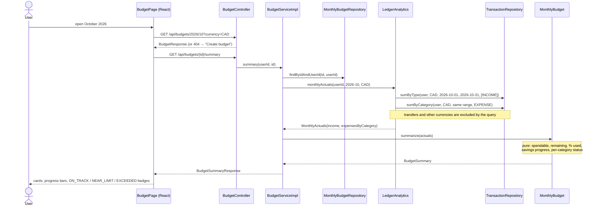
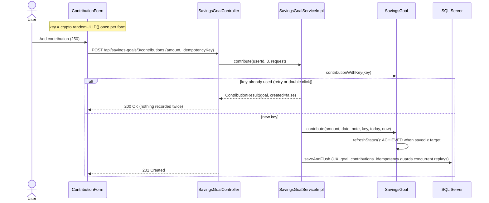
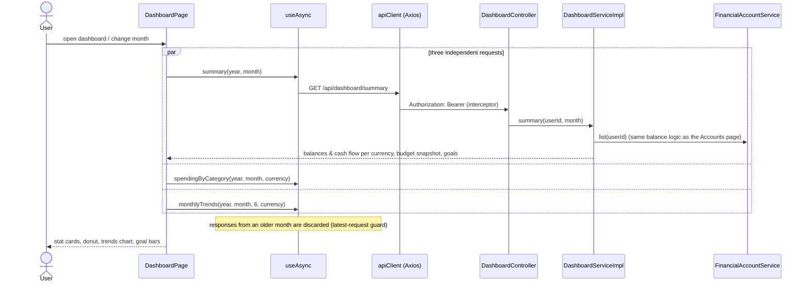
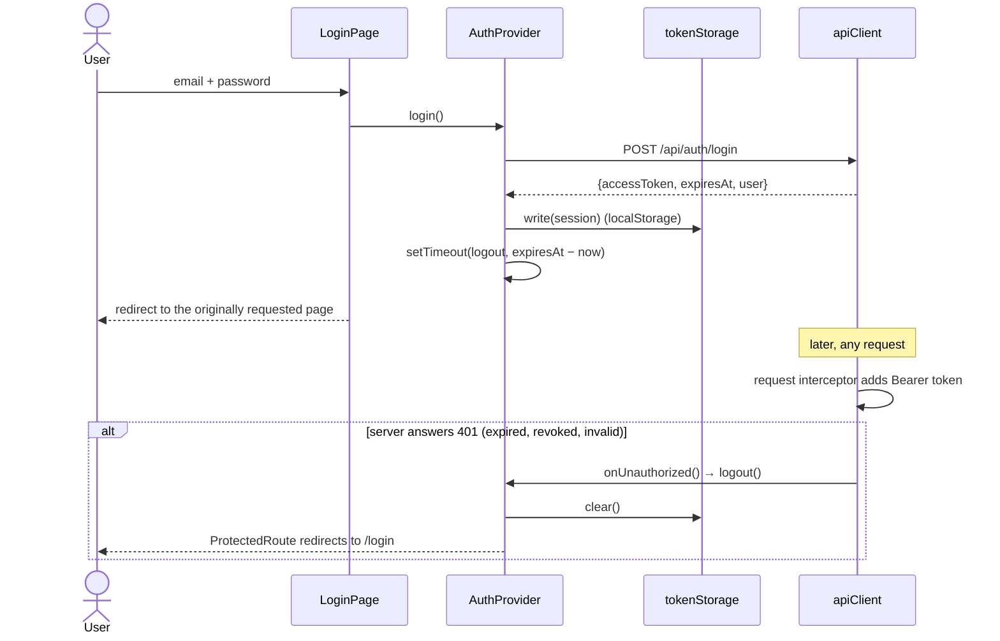

# Sprint 2 — Sequence Diagrams

## 1. Budget Summary (Plan vs. Actual)



## 2. Revise a Budget (Plan and Allocations Together)

```mermaid
sequenceDiagram
    participant S as BudgetServiceImpl
    participant CR as CategoryRepository
    participant B as MonthlyBudget
    participant ST as SavingsStrategyType
    participant R as MonthlyBudgetRepository

    S->>CR: findVisible(categoryId, userId) for each allocation (404 if not visible)
    S->>B: revise(income, strategy, value, specs)
    B->>ST: create(value).savingsFor(income)
    Note over B: validate EVERYTHING first:<br/>savings ≤ income, EXPENSE categories,<br/>no duplicates, Σ limits ≤ spendable
    alt invalid
        B-->>S: BusinessRuleException (422), budget unchanged
    else valid
        B->>B: apply plan; update kept rows in place; add new; orphan-remove dropped
        S->>R: saveAndFlush(budget)
        Note over R: updating rows in place avoids an insert-before-delete<br/>collision on UQ(budget_id, category_id)
    end
```

## 3. Idempotent Goal Contribution



## 4. Dashboard Load (Frontend to Backend)



## 5. Session Handling in the Browser


