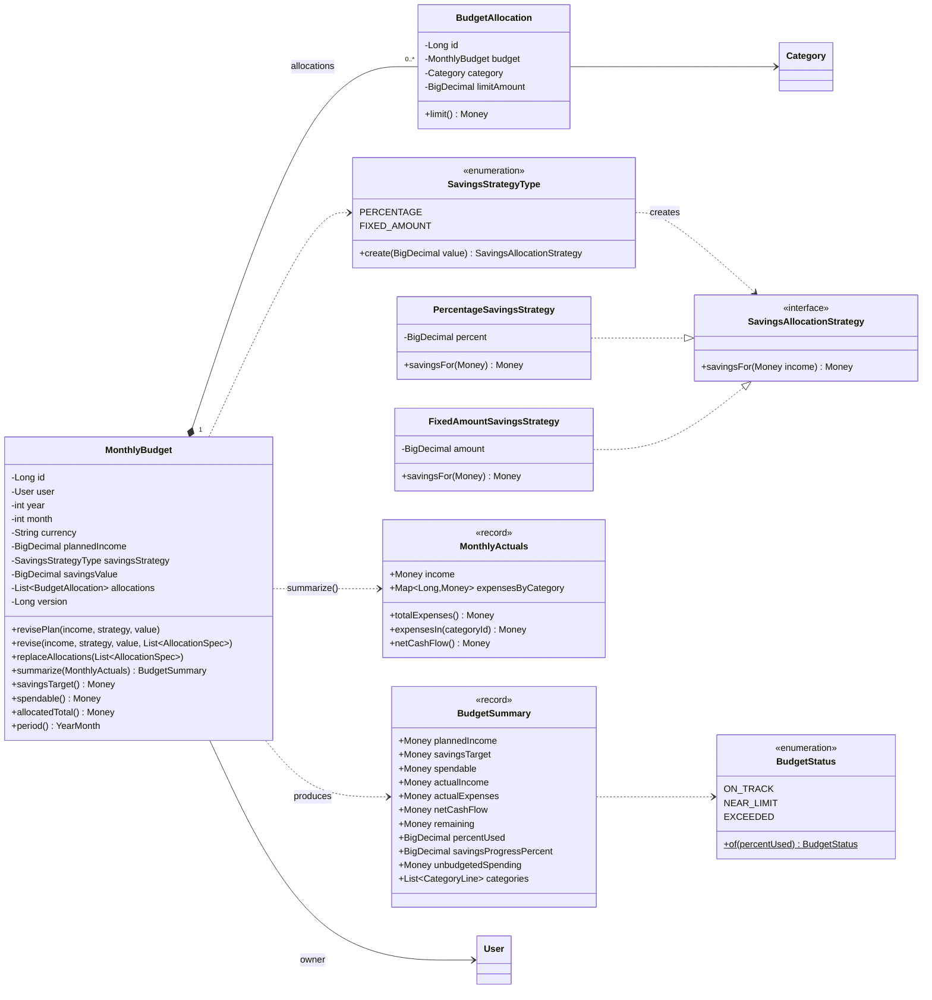
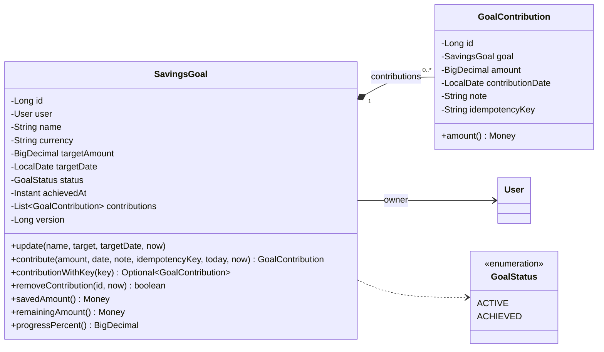
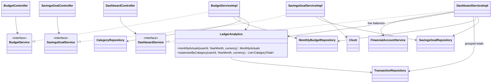

# Sprint 2 — Updated Class Diagram

These are the classes added in Sprint 2. Sprint 1 classes are unchanged ([as-built Sprint 1 diagram](../sprint1/uml_class_diagram.md)), except for one additive change: `TransactionRepository` gained the analytics queries.

## 1. Budgeting Domain

## 2. Savings Goals

## 3. Services and Controllers

## Design Notes

- **Strategy and factory:** `SavingsAllocationStrategy` is the Strategy pattern. Percentage and fixed amount are interchangeable algorithms behind one interface. `SavingsStrategyType` is a factory: the database stores the type and value, and the enum rebuilds the behaviour. Adding a strategy (for example "percentage above a floor") means adding a class and an enum constant. `MonthlyBudget` doesn't change (open/closed).
- **Pure calculation:** `MonthlyBudget.summarize(MonthlyActuals)` performs no I/O. `LedgerAnalytics` performs the queries and hands over a value object. The arithmetic is unit-tested without a database, and the queries are integration-tested separately.
- **Composition:** allocations and contributions are owned by their aggregate and are saved and deleted through it. Neither is ever modified on its own.
- **`LedgerAnalytics` is a class, not an interface:** it has one implementation and no reason to vary, so an interface would only add indirection. This follows the "no unnecessary abstractions" rule.
